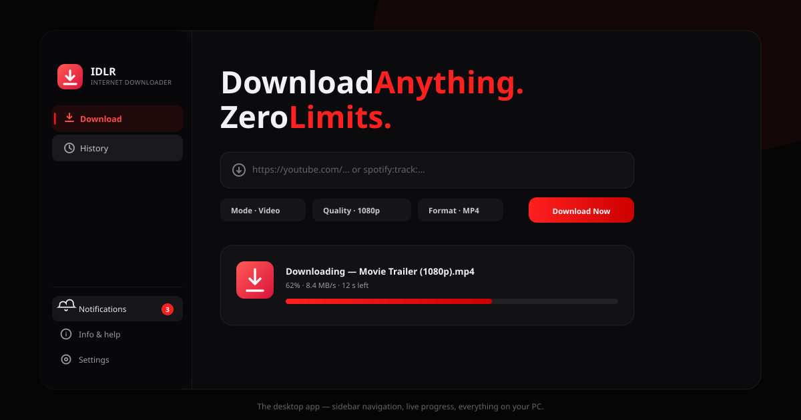

# ⚡ IDLR App — Internet Downloader

**Paste a link. Get the file.** YouTube, Spotify, TikTok, Instagram, Twitch, HLS streams and 1000+ more — downloaded straight to your PC. No ads, no redirects, nothing leaves your machine.


> **Current version: v2.0.12** — a native desktop app with a bundled media engine, plus an optional browser view you open on purpose.

### 📥 [Download for Windows](https://github.com/Makerxm800/IDLR-App/releases/latest/download/IDLR-App-Setup.exe) · [All platforms (Linux · macOS)](https://github.com/Makerxm800/IDLR-App/releases/latest)

*Windows: 64-bit Intel/AMD (ARM laptops work via x64 emulation; no 32-bit build). Linux: AppImage + .deb. macOS: DMG (right-click → **Open** the first time — builds are not Apple-notarized).*

---



**Two views, one app.** The installed app is a native window with a sidebar: Download and History on top, Notifications, Info & help, Settings and your account below. If you prefer a browser, open **Settings → System → Browser URL → Open** — same accounts, same history, same downloads, responsive layout. It never opens by itself.

---

## ✨ What it does

- 🌐 **1000+ sites** via yt-dlp — video and audio, playlists included
- 🎵 **Spotify** tracks, albums & playlists via spotdl (YouTube match fallback)
- 🔍 **Instant link detection** — paste and the platform, mode and format set themselves
- 🖼️ **Preview before you download** — title, cover, duration; save cover art alone with one click
- 📂 **Show in folder** — every finished download opens right at the file
- 📋 **History that manages itself** — search, star ★, rename, re-download, trash & restore
- 🎨 **6 themes + Liquid Glass**, with a Calm Motion switch for accessibility
- 👤 **Guest mode** — no account needed; data stays in `~/.idlr_app/` on your PC only
- 🔔 **In-app alerts** when downloads finish or fail — no browser permission needed
- 🚀 **Fast launch** — dark from the first frame, fonts never block the window, the media engine warms up while the app opens

## 🧩 Supported platforms

| Platform | Video | Audio | Notes |
|----------|:-----:|:-----:|-------|
| YouTube  | ✅ | ✅ | Playlists supported |
| Spotify  | — | ✅ | MP3 / M4A / OPUS / FLAC |
| SoundCloud | — | ✅ | Auto-switches to Audio |
| TikTok · Instagram · Twitch · Vimeo · Facebook · Reddit · X · Dailymotion | ✅ | ✅ | Clips & VODs included |
| HLS / `.m3u8` streams | ✅ | ✅ | Non-DRM streams; merged via FFmpeg |
| Direct `.mp4/.mkv/.webm` files | ✅ | ✅ | Remuxed only if you pick another container |
| + 1000 more | ✅ | ✅ | yt-dlp generic extractor |

## 🖥️ Using it

1. **Paste a link** — the platform badge appears automatically.
2. **Pick Mode / Quality / Format** — or let auto-detect choose.
3. **Download Now** — live progress, speed and ETA in the app.
4. **Find it later in History** — search, star, rename, or **Show in folder**.
5. **Settings (gear)** — every switch takes effect immediately.

## ⚙️ Settings worth knowing

| Setting | What it does |
|---------|--------------|
| Theme | Midnight, Light, Ocean, Sunset, Forest, Rosegold — applied before first paint |
| Auto-detect URL | Paste sets Mode/Format for the platform; OFF = badge only |
| Download Thumbnail | Embeds cover art; OFF = faster, fewer FFmpeg errors |
| Full Playlist | One link downloads the whole playlist |
| Download Alerts | Bell notification when a job finishes or fails |
| Calm Motion | Minimises every animation, including the sidebar hovers |
| Save folder | Where files land; click the path bar to change |
| Browser URL | Open or copy the optional browser view's local address |

## 🐛 Quick fixes

| Problem | Fix |
|---------|-----|
| YouTube `403` / `Sign in to confirm` | Settings → **Update yt-dlp**, retry. Age-restricted/DRM content can't be downloaded |
| Spotify fails | Link must be public; IDLR falls back to a YouTube match automatically |
| `No downloadable video found` | The page is login-walled, JS-only, or DRM-protected (e.g. Netflix) |
| ⚠ No FFmpeg | Install FFmpeg and restart IDLR — it re-checks before every download |
| App won't open | Check `~/.idlr_app/idlr.log`; Windows needs WebView2, Linux needs GTK 3 + WebKit2GTK 4.1 |
| Downloads never start | Antivirus may have quarantined the helper — the app shows a banner with **Try again** and recovery steps |
| App is flagged by Defender/SmartScreen | Unsigned download tools get heuristic flags; see [the antivirus notes](docs/antivirus.md) |

---

## 🛠️ Build & develop

**Run from source** (Python 3.10+, Node.js LTS, Rust stable; Windows also needs VS C++ Build Tools):

```powershell
npm ci
py -3 -m venv .venv
.\.venv\Scripts\python.exe -m pip install -r requirements-build.txt
npm run tauri -- dev          # native app in dev mode
python app.py --browser       # or just the browser UI + Flask API
```

**Test:** `python -m unittest discover -s tests` (130 tests; also runs on every PR, on all three OSes).

**Release:** `python scripts/set_version.py X.Y.Z`, add the What's New entry in `index.html` and a changelog entry below, then `git tag vX.Y.Z && git push origin vX.Y.Z`. The release workflow tests, builds signed Windows/Linux/macOS installers, and publishes them with the updater manifest. `python scripts/set_version.py --check` verifies all seven version files agree.

| To change… | Edit… |
|---|---|
| UI, layout, text, themes | `index.html` |
| Download logic, API | `app.py` |
| Native shell (commands, window, file actions) | `src-tauri/src/lib.rs` |
| Packaging & signing | `build.py` |
| Release pipeline | `.github/workflows/idlr-app-release.yml` |

<details>
<summary><strong>Packaging, signing & antivirus notes</strong></summary>

- The media worker and Spotify helper are bundled as private resources — the installed app needs **no Python installation**.
- FFmpeg is bundled once beside the helpers (not inside each), which is why the installer is ~148 MB instead of 235 MB.
- Helpers carry real version metadata and UPX packing is off — the two biggest antivirus heuristics.
- Set `IDLR_SIGN_THUMBPRINT` on a machine with `signtool` and a certificate, and `build.py` signs the helpers and the installer.
- Updater packages are signature-verified by Tauri. Generate the key once with `npm run tauri -- signer generate -w "$env:USERPROFILE\.tauri\idlr-updater.key"`, keep the private key backed up, and add it as the `TAURI_SIGNING_PRIVATE_KEY` Actions secret (plus `TAURI_SIGNING_PRIVATE_KEY_PASSWORD` if used).
- The macOS leg is best-effort: if its runner is unavailable, the release ships without a DMG and macOS installs simply take the next one.
- If Windows removes the helper: **Windows Security → Virus & threat protection → Protection history → Allow on device**, then add an exclusion for the IDLR folder and reinstall.

</details>

---

## 📜 Changelog

### v2.0.12 — faster to open, calmer to look at

- **Instant first paint** — fonts load in the background (they used to blank the window on slow networks), and the window is dark from its first frame.
- **The media engine warms up during launch** — its self-extraction used to be paid on your first click.
- **The sidebar grew up** — slim ghost rows with a white hover wash, a gentle press, and icons that answer (the bell rings, the gear turns).
- **Tab hover you can see**, and no more tooltip repeating the tab's own name.

### v2.0.11 — the browser asks first, and the folder button exists

- **No more surprise browser window** at launch — the browser view is a button in Settings.
- **Show in folder works** — the native app finally answers `/api/reveal` (the "Unknown IDLR command." bug) and opens the real file.
- **HLS/movie downloads stop lying** — signed streams are detected, your quality choice is honoured, and a missing segment fails visibly instead of finishing with minutes missing.
- **Direct links keep your format** — audio mode stays audio; video remuxes only when asked.

<details>
<summary><strong>Older releases</strong></summary>

- **v2.0.10** — the folder buttons, notifications and switches all do what they say; path normalisation fixed the "not in your history" refusal.
- **v2.0.9** — toggle tooltips unclipped; the Spotify warning can be retracted by a healthy download.
- **v2.0.8** — the false "Spotify unavailable" banner fixed for good; notifications fit on screen; hover sheen only on hover.
- **v2.0.7** — history records where files went (size + folder button); real SVG icons replace ~80 emoji; What's New is data.
- **v2.0.6** — the app opens even when the helper is quarantined; nothing self-modifies at runtime; FFmpeg ships once; faster fragmented downloads.
- **Earlier** — see the [full release history](https://github.com/Makerxm800/IDLR-App/releases).

</details>

---

**100% local.** Accounts, history and settings live in `~/.idlr_app/` on your machine. The only network traffic is the download request to the source site — plus update checks, if you ask for them.

**License:** MIT
